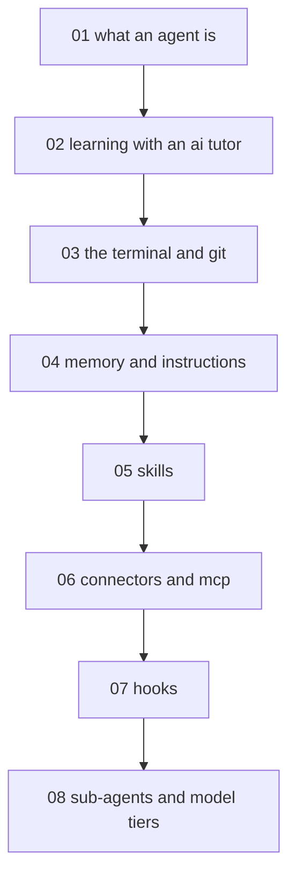

# Agentic AI from zero - map

**Audience:** complete beginners to agentic AI with no command-line or programming
experience - comfortable with a computer and a chat assistant; learns the terminal and git
along the way. **Estimated time:** 16-20 hours across 8 modules, hands-on from the first
module.

<!-- meno:derived:start -->

**01 what an agent is** (planned)
**02 learning with an ai tutor** (planned)
**03 the terminal and git** (planned)
**04 memory and instructions** (planned)
**05 skills** (planned)
**06 connectors and mcp** (planned)
**07 hooks** (planned)
**08 sub-agents and model tiers** (planned)
<!-- meno:derived:end -->

## My notes
(human territory; never regenerated)
